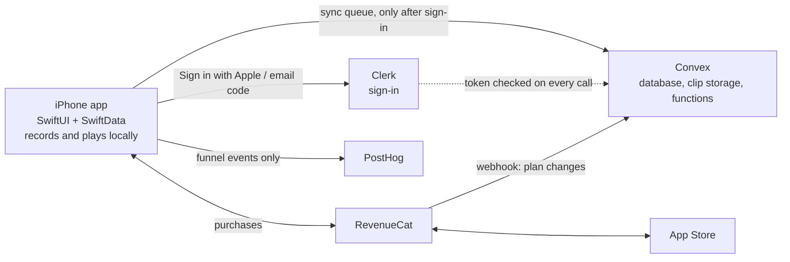

# Worked example: the Chatterbox build plan

A real, approved build plan for Chatterbox, a native iPhone app (SwiftUI, offline first, hard paywall) that asks a young child one question a day and keeps the recordings. It is the calibration for `docs/6-BUILD-PLAN.md`: this level of specificity, at about this length.

**Copy:** the section order; how Key choices names the alternative it turned down; Core logic covering only what an agent would get wrong (the question engine, sync, subscription states, notifications, the one-year re-ask); the phase order — setup, design catalogue, the offline core loop, first run, accounts, payments, then the rest, then launch; and every phase ending in a **Done when** a person can check on a phone.
**Don't copy:** its stack. Swift, Convex, Clerk and RevenueCat fit an offline-first iPhone app with a subscription; pick each product's stack fresh. Numbers like (1.9) are screens on Chatterbox's design canvas; yours point at the flows in `docs/5-FLOWS.md`.

## Contents

- [Stack](#stack)
- [Key choices](#key-choices)
- [Architecture](#architecture)
- [Data model](#data-model)
- [Core logic](#core-logic)
- [Build phases](#build-phases)
- [Launch requirements](#launch-requirements)
- [Open questions](#open-questions)

---

# Build plan: Chatterbox

Status: Done
Updated: 2026-10-29

Chatterbox v1 is a native SwiftUI iPhone app that works offline first, uses Clerk for sign-in and Convex for data and private backup, and RevenueCat for the hard paywall. It is built in 11 phases, each ending in something you can test on a phone. The screens and flows it implements are on the design canvas.

## Stack

Everything that can live on the phone does, so the first chat works with no account and no signal. The server only holds backups, accounts and subscription state.

| Layer | Choice | Why |
| --- | --- | --- |
| Language and UI | Swift 6, SwiftUI, iOS 17+ | iOS 17 is the first version with SwiftData and the Observation framework |
| Local storage | SwiftData, with audio files in Application Support | Works offline and keeps the first run free of sign-up |
| Audio | AVFoundation (AVAudioRecorder, AVAudioPlayer) | AAC mono at 48 kbps is about 360 KB a minute, so roughly 130 MB a year per child at one daily chat |
| Auth | Clerk: Sign in with Apple + email one-time code | Native iOS SDK that matches screen 1.9, and Convex’s officially supported Swift auth integration |
| Database | Convex | Typed schema and live queries; every function checks the signed-in parent |
| File storage | Convex file storage | Clips sit beside their records, and only the parent’s own functions hand out their URLs |
| Server code | Convex actions and HTTP actions (TypeScript) | Only two jobs: account deletion and the RevenueCat webhook |
| Payments | RevenueCat (purchases-ios) on StoreKit 2 | Yearly with a 7-day trial and weekly; entitlement checks and receipt handling are done for you |
| Notifications | Local notifications (UserNotifications) | The nudge, trial reminder and re-asks can all be scheduled on the device, so no push server in v1 |
| Analytics | PostHog | Funnels and retention for the first run and paywall; session replay off, and no audio or child data sent |
| Crash reporting | Xcode Organizer for v1; add Sentry if needed | Keeps third-party SDKs to a minimum |
| Packages | Swift Package Manager: ConvexMobile, clerk-ios, clerk-convex-swift, purchases-ios, posthog-ios | Five packages, all from the services already chosen |

## Key choices

### Auth and database

**Choice: Convex** for the database, clip storage and server code, with **Clerk** for sign-in. The phone stays the source of truth and Convex is the backup.

How they fit together:

- **Sign-in.** Clerk’s iOS SDK handles Sign in with Apple and the 6-digit email code, so screen 1.9 works as drawn. Convex’s Swift client supports Clerk out of the box through `clerk-convex-swift`, and Convex checks Clerk’s token on every call.
- **One account ties everything together.** The Clerk user id becomes the RevenueCat app user id, so a subscription follows the parent to a new phone.
- **Privacy lives in the functions.** Convex has no row-level security, so every query and mutation goes through one `requireParent` helper that loads the signed-in parent and refuses anything they don’t own. Lint for it in code review.
- **Server code is just TypeScript** in a `convex/` folder: the schema, the functions, the RevenueCat webhook and account deletion, all deployed with one command.
- **Room to grow.** Live queries make co-parent sharing or a web player straightforward later.
- **Cost.** Audio storage and bandwidth are the main costs, at roughly 130 MB a year per child. Check Convex’s and Clerk’s current pricing against your expected number of families before launch.

How sign-up fits the first run: nothing touches the server until the parent taps “Back it up” on 1.9. Before that, the child, the first clip and the settings live only in SwiftData. Signing in uploads them and then shows the paywall, so the purchase is made by a known account.

**Alternative considered: CloudKit.** Clips would sit in the parent’s own iCloud, with no server and no storage bill. It loses on email sign-in, it’s Apple-only, and co-parent sharing and support are much harder.

## Architecture

The app never waits on the network: it records and plays from its local store, and the sync queue copies clips up to Convex once the parent has signed in with Clerk. RevenueCat sits between the app and the App Store and tells Convex about plan changes through a webhook. PostHog only receives funnel events.

## Data model

Six Convex tables, defined in `convex/schema.ts`, back the app; the first four mirror SwiftData models on the phone. Every synced model also carries a local `syncState` (local, uploading, backedUp) that never leaves the device. Convex adds `_id` and `_creationTime` to every row.

| Table | Key fields | Notes |
| --- | --- | --- |
| `parents` | `clerkId`, `nudgeTime`, `timezone` | One row per parent, created on first sign-in. Indexed by `clerkId` |
| `children` | `parentId`, `name`, `birthday`, `pal`, `questionMode` (auto, pickOne, open) | `auto` means pick-one under 3 and open from 3 |
| `clips` | `childId`, `parentId`, `localId`, `questionId`, `questionText`, `questionType`, `recordedAt`, `durationMs`, `choice`, `favourite`, `reaskOf`, `audio` (storage id), `deletedAt` | Question text is copied in, so editing the library never changes history. `localId` makes retried uploads safe. `reaskOf` links a one-year-on clip to its original (4.5 pair) |
| `dailyLog` | `childId`, `date`, `questionId`, `status` (asked, swapped, skipped, recorded) | Drives no-repeats, “waited longest goes first” and the week strip |
| `questions` | `text`, `type`, `ageMinMonths`, `ageMaxMonths`, `mode`, `choices`, `tip`, `active` | Read-only for the app. A snapshot ships in the app bundle so the first run works offline |
| `subscriptions` | `parentId`, `entitlement`, `status`, `periodType`, `expiresAt` | Written only by the RevenueCat webhook. Used for support and future server-side checks |

**File storage.** The app asks a mutation for an upload URL, uploads the m4a straight to Convex, then saves the returned storage id on the clip. Upload URLs expire after an hour, so the background queue fetches a fresh one for each upload. Playback URLs come only from a query that checks the parent owns the clip, and files are cached after first play.

**Access rules.** Every public function starts with `requireParent(ctx)`, which reads Clerk’s identity from `ctx.auth` and loads the parent. Each read and write is then filtered by `parentId`. Functions that should never be called from the app, such as the webhook’s writes and deletion clean-up, are `internal` functions.

## Core logic

Six pieces of logic carry the product. Each one is a plain Swift type with unit tests, kept separate from the views.

**Daily question engine.** It picks one question per child per day:

1. If a clip from exactly a year ago exists, today’s question is that re-ask (see below).
2. Otherwise it takes the next type in the rotation Feelings → Imagination → My day → Big wonders, so “the pals take turns”.
3. It filters by the child’s age in months and question mode, and skips anything asked in the last 365 days.
4. It seeds the choice from child id + date, so the question is stable all day and can be known in advance for the notification.

Swap (2.3) offers three alternatives, one from each other type. “Not today” logs a skip and changes nothing else: there are no streaks.

**Recording.**

- Audio session `.playAndRecord`, AAC mono at 22.05 kHz and 48 kbps.
- The Background Modes audio capability keeps recording going if the phone locks mid-bath.
- Handles interruptions such as calls and Siri, with a 10-minute cap.
- The waveform comes from live metering.
- The microphone permission is asked on the first Record tap (1.6), not before.

**Sync.**

- Every clip is written locally first.
- A background upload queue (background `URLSession`) gets a fresh upload URL, sends the file, then calls `saveClip` with the storage id, retrying with backoff.
- On a new phone, sign-in pulls children, clips and the log, and audio downloads when first played.
- Deletes are soft (`deletedAt`) so they sync cleanly.

**Subscription states.** One `EntitlementStore` listens to RevenueCat’s customer info and drives the root view:

| State | When | What the parent sees |
| --- | --- | --- |
| No plan yet | Signed in, never subscribed | Hard paywall (1.10), which reopens until they subscribe |
| Free week | Entitlement active, period type trial | Full app, plus the trial card on Your plan (5.2) |
| Active | Entitlement active, normal period | Full app |
| Ended | Entitlement expired | Plan ended (5.4): questions paused, their Chatterbox still plays, stars and exports (5.5) |

Trial copy only shows when RevenueCat’s intro-offer eligibility check says yes. That is how Pick up again (5.7) shows no trial without extra logic, since Apple allows one free trial per subscription group. Cancelling and switching plans open Apple’s own manage-subscriptions sheet; apps can’t cancel in-app.

**Notifications.** These are all local, rescheduled on each launch and after each chat, and kept within iOS’s 64 pending notifications:

- The daily nudge at the parent’s chosen time. It includes the question text and has Ask now and Not today actions, and covers all children in one notification (3.1).
- The trial reminder 4 days after the trial starts (5.1).
- “A year ago today” re-asks (4.1).
- The win-back nudge the week before a child’s birthday when the plan has ended (5.6).

**One year on.**

- A clip recorded 365 days ago makes its question the child’s question for today. If that day was missed, it waits at the top of Today for up to 7 days.
- The old clip stays locked until the new one is recorded, so it can’t steer the answer (4.2).
- Then and Now plays both clips back to back, and saving sets `reaskOf` (4.5).
- A pick-one question first asked at 2 comes back as an open question at 3.
- A debug menu sets a fake date and seeds a year of history, because this can’t be tested any other way.

## Build phases

The phases run in order. The app is offline-only until phase 4 and free until phase 5, so the core loop is proven before accounts and payments add complexity. Screen numbers refer to the design canvas.

### 0. Accounts and project setup

- [ ] Apple Developer: bundle id, App Store Connect app record, and an App Store name check for Chatterbox
- [ ] Xcode project: SwiftUI, iOS 17 minimum, Swift 6; capabilities for Sign in with Apple, In-App Purchase and Background Modes (audio)
- [ ] Convex: one project with dev and prod deployments, and the `convex/` folder in the repo
- [ ] Clerk: dev and prod instances with Apple and email code sign-in, set as the auth provider in `convex/auth.config.ts`
- [ ] PostHog project, with session replay off and no capture of on-screen text
- [ ] RevenueCat project linked to App Store Connect (API key, plus App Store Server Notifications v2 pointed at RevenueCat)
- [ ] Debug and Release xcconfigs holding each environment’s Convex URL and the Clerk, RevenueCat and PostHog keys

Done when: an empty app builds to a phone from both configurations.

### 1. Design system and Shape Pals

- [ ] Colour tokens, with Unbounded and Figtree bundled (both under the Open Font License) and a type scale
- [ ] Button styles (primary, light, ghost, white), chips, cards, sheet, toast, three-tab bar (Today, Questions, Chatterbox)
- [ ] Bloop, Tri, Squish and Arch drawn as SwiftUI shapes with happy, wow and sleepy moods and a small idle bounce
- [ ] Shared components: question card, player card, waveform, option row, week strip
- [ ] A hidden catalogue screen showing every component

Done when: the catalogue matches the canvas side by side.

### 2. Local core, offline

- [ ] SwiftData models: Child, Clip, DailyLog, Settings
- [ ] Bundled `questions.json` and the daily question engine, with unit tests
- [ ] Recorder: record, pause, finish, interruptions, locked screen
- [ ] Listen back (2.5) with redo, keep and star
- [ ] Child’s Chatterbox list (2.6) with filters for All, Favourites and One year on
- [ ] Pick-one questions: two picture choices, with the tapped choice saved on the clip (3.5)

Done when: you can add a child, get today’s question, record, keep and replay it with no network.

### 3. First run

- [ ] Welcome (1.1), Meet the Shape Pals (1.2), Add child (1.3)
- [ ] Nudge time (1.4) with the notification permission request
- [ ] First question, record, keep it, first chat saved (1.5–1.8)
- [ ] Not right now branch (1.12)
- [ ] Onboarding step saved, so a killed app resumes where it left off

Done when: a fresh install reaches “The first chat in Milo’s Chatterbox” in under a minute.

### 4. Accounts and backup

- [ ] Back it up (1.9): Clerk Sign in with Apple and email code, connected to Convex through `clerk-convex-swift`
- [ ] Clerk emails sent from your own domain so codes don’t land in spam
- [ ] Schema, the `requireParent` helper and all functions, with `convex-test` tests proving one parent can never read another’s data
- [ ] Upload queue, and the backed-up state shown per clip
- [ ] Restore on a second phone
- [ ] `deleteAccount` action, which removes files, rows and the Clerk user

Done when: sign in on a second phone and the first chat plays there.

### 5. Payments

- [ ] App Store Connect subscription group with `chatterbox.yearly` ($39.99, 1-week free trial) and `chatterbox.weekly` ($4.99, no trial)
- [ ] RevenueCat entitlement `plus`, plus a `default` offering with annual and weekly packages
- [ ] Configure RevenueCat anonymously at launch; `logIn(clerkUserId)` after sign-in and `logOut` on sign-out
- [ ] Custom SwiftUI paywall (1.10) built from offerings, with Restore, Terms and Privacy links
- [ ] Free week starts (1.11), Your plan (5.2), You’re all set (5.3)
- [ ] `EntitlementStore` and the root gate for all four states
- [ ] StoreKit configuration file for local testing, then sandbox
- [ ] RevenueCat webhook → Convex HTTP action (checks the shared secret) → `subscriptions` table

Done when: a sandbox account can start the trial, see the day-5 reminder, cancel, expire and resubscribe without a second trial.

### 6. Daily loop

- [ ] Today (2.2), Swap (2.3), Record (2.4), Saved toast (2.6), Done (2.7), Not today (2.8)
- [ ] Daily nudge with Ask now and Not today actions, deep-linking straight into recording (2.1)
- [ ] Rolling notification scheduler

Done when: a week of real use on one phone feels right.

### 7. Several children

- [ ] One nudge for all children (3.1), with the child who has waited longest first (3.2)
- [ ] Child switcher sheet (3.3), Add a child (3.4), each child’s own Chatterbox (3.6)
- [ ] A per-child question mode setting (auto, pick-one, open)

Done when: two children each get the right kind of question every day.

### 8. One year on

- [ ] Re-ask detection in the engine, plus the “A year ago today” notification (4.1)
- [ ] Same question with the old clip locked (4.2), Record (4.3), Then and Now (4.4), Saved as a pair (4.5), Snooze (4.6)
- [ ] Debug menu with a date override and a seeded year of history

Done when: a seeded child gets a re-ask and the pair saves correctly.

### 9. Settings, export and privacy

- [ ] Settings: children, nudge time, plan, restore purchases, privacy and terms, delete account
- [ ] Export all: zip of m4a files plus an index CSV, through the share sheet (5.5)
- [ ] Plan ended (5.4), Still yours (5.5), win-back notification (5.6), Pick up again (5.7), Welcome back (5.8)
- [ ] Privacy manifest (`PrivacyInfo.xcprivacy`)
- [ ] PostHog funnel events (first chat saved, backed up, trial started, converted) and day-7 retention, identified by Clerk user id and carrying no child names or question text

Done when: an expired account can still play and export every clip.

### 10. Beta and launch

- [ ] TestFlight with 5–10 families for two weeks
- [ ] The test checklist under Launch requirements
- [ ] App Store listing, screenshots from the canvas, privacy policy and support pages
- [ ] Submit, with review notes covering the hard paywall and sign-in

Done when: the app is live in the App Store.

## Launch requirements

Most App Review rejections for an app like this come from the paywall, sign-in and privacy, so build these in rather than fixing them at submission.

**Review requirements.**

- **Paywall:** price, trial length and renewal terms must be clear, with working Restore, Terms and Privacy links. 1.10 already has all of these.
- **Sign-in:** Sign in with Apple is offered, so no extra login option rules apply. Add a reviewer email account to the review notes, with a way to sign in that doesn’t need an inbox (for example a fixed code for that one account).
- **Account deletion:** it must be possible in the app, not just by email (in Settings, phase 9).
- **Category:** list it in Lifestyle or Education, **not** the Kids category. The parent is the user, and the Kids category adds strict limits on third-party analytics and SDKs.
- **Privacy labels:** audio and user content are collected, linked to the user, and not used for tracking. The privacy policy states that recordings are private, encrypted at rest and never used to train AI.

**Test checklist before submitting.**

- [ ] Record through a phone call, Siri, a locked screen and airplane mode
- [ ] Kill the app mid-upload, then reopen it
- [ ] Sign in on a second phone and play an old clip
- [ ] Sandbox: start the trial, wait for renewal, cancel, let it expire, resubscribe (sandbox renews a week in about 3 minutes and a year in about 1 hour)
- [ ] Restore purchases on a fresh install
- [ ] Delete the account and confirm the files are gone from storage
- [ ] VoiceOver and Dynamic Type on Today, Record and the paywall

## Open questions

- [ ] **App Store name.** “Chatterbox” on its own is probably taken. Check it in App Store Connect in phase 0, and have a fallback ready such as “Chatterbox: Ask Your Kids”.
- [ ] **Age range at launch.** The plan assumes 2–6. Going up to 10 needs a third question tier (would-you-rather and debate-style questions).
- [ ] **Question library.** Roughly 4 types × 3 age bands × 30+ questions, about 400 in total, so no question repeats inside a year. Decide who writes and reviews them; Claude can draft a first set.
- [ ] **Co-parent sharing.** Left out of v1, but the schema leaves room for it. Decide if it’s v1.1.
- [ ] **Clip length cap.** The plan uses 10 minutes. Confirm, or make it 5 to keep storage down.
- [ ] **Data region.** Check which regions Convex, Clerk and PostHog offer (PostHog has US and EU clouds). Pick EU where you can if UK and EU parents are the first market.
